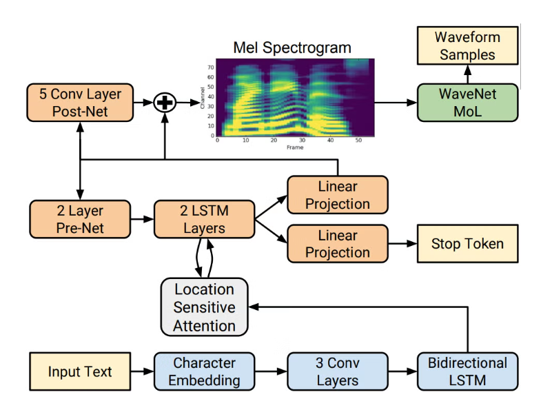
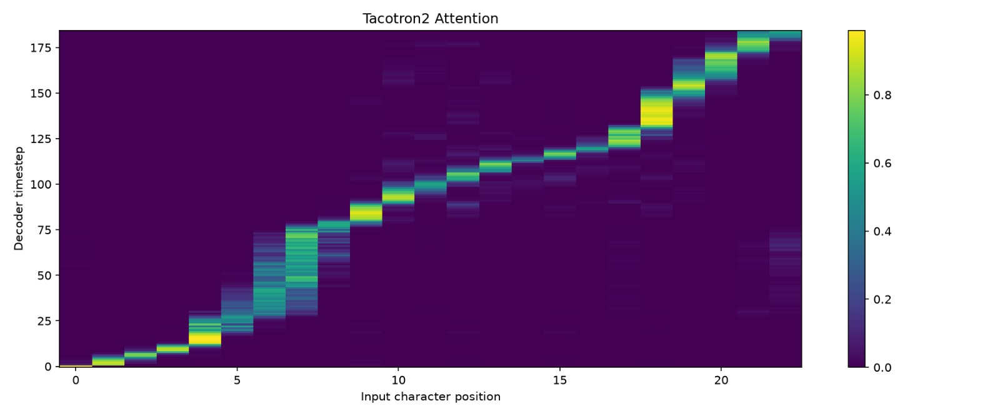

# Tacotron 2 Text-to-Speech From Scratch

A neural text-to-speech system: a **Tacotron 2** model trained from scratch on **LJ Speech**, a pretrained **HiFi-GAN** vocoder, and a **Streamlit** app for interactive synthesis.

Text → Mel spectrogram (Tacotron 2) → Waveform (HiFi-GAN) → 22,050 Hz WAV



*Tacotron 2 architecture. In this project, HiFi-GAN replaces the WaveNet vocoder shown in the diagram.*

## Details

- **Dataset:** [LJ Speech](https://keithito.com/LJ-Speech-Dataset/) (approx. 13,000 clips, single speaker)
- **Acoustic model:** Tacotron 2, trained from scratch
- **Vocoder:** pretrained HiFi-GAN (LJ Speech)
- **Stack:** Python, PyTorch, Streamlit
- **Output:** WAV, 22,050 Hz

## Result

The attention plot shows a clear diagonal alignment between text and speech.



## Features

- Text-to-speech synthesis through an interactive Streamlit interface
- Cached model loading (Streamlit resource caching) to avoid repeated initialization
- Cached audio for repeated identical inputs
- Sentence-by-sentence synthesis of long passages, with the segments concatenated, to avoid truncation
- Command-line synthesis path for generating WAV files

## Getting Started

### Prerequisites

- Python 3.9 or later
- A CUDA-capable GPU is recommended for training; inference can also run on CPU, but more slowly

### Installation

```bash
git clone https://github.com/Hersheyysyrup/Tacotron2-From-Scratch.git
cd Tacotron2-From-Scratch
pip install -r requirements.txt
```

### Dataset

Download [LJ Speech](https://keithito.com/LJ-Speech-Dataset/) and extract it into the project's data directory (see the training script for the expected path).

### Model checkpoints

Place the trained Tacotron 2 checkpoint and the pretrained HiFi-GAN (LJ Speech) checkpoint in the locations expected by the inference code.

### Run the web app

```bash
streamlit run app.py
```

Enter text in the app, generate speech, and play or download the audio.

## Training

The model was trained on LJ Speech for 40 epochs on a single RTX 4050 (8 GB). The original plan was 60 epochs, but training was slow and crashed at around epoch 30, so the schedule was reduced to 40.

## Known Limitations

- Roman numerals are not pronounced correctly.
- Years such as 2000 are read digit by digit ("two zero zero zero") instead of in natural spoken form.
- **Punctuation:** semicolons and colons cause problems in the Streamlit app.
- **Voice quality:** the synthesized voice has an occasional rattled quality.

## Future Work

- Add a text normalization front-end for years, numbers, roman numerals and abbreviations (for example with `num2words` or `inflect`)
- Sanitize unsupported punctuation in the Streamlit preprocessing step
- Train for more epochs (60 or more) with checkpoint resumption and learning-rate scheduling
- Fine-tune HiFi-GAN on Mel spectrograms predicted by the trained Tacotron 2 model
- Add guided attention loss for more robust alignment
- Use mixed-precision training and gradient accumulation to reduce memory use and training time

## References

- [LJ Speech Dataset](https://keithito.com/LJ-Speech-Dataset/)
- [priyammaz/Tacotron-From-Scratch: Let's create a TTS model!](https://github.com/priyammaz/Tacotron-From-Scratch)
- [NVIDIA/tacotron2: Tacotron 2 - PyTorch implementation with faster-than-realtime inference](https://github.com/NVIDIA/tacotron2)
